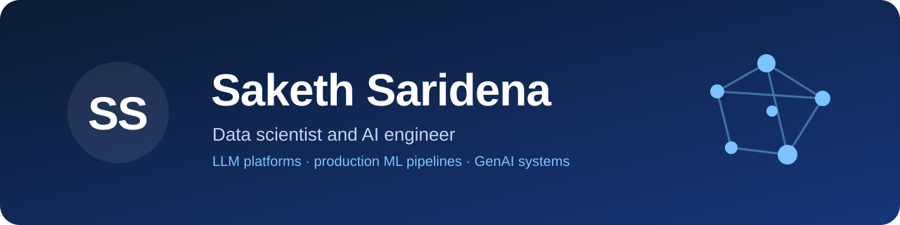
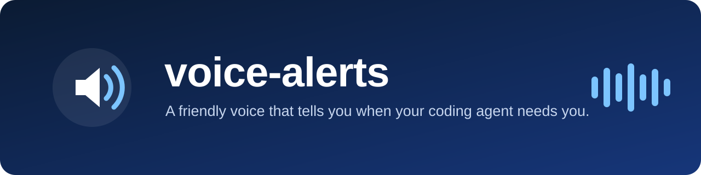
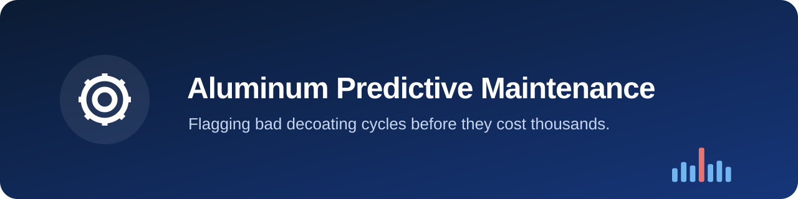
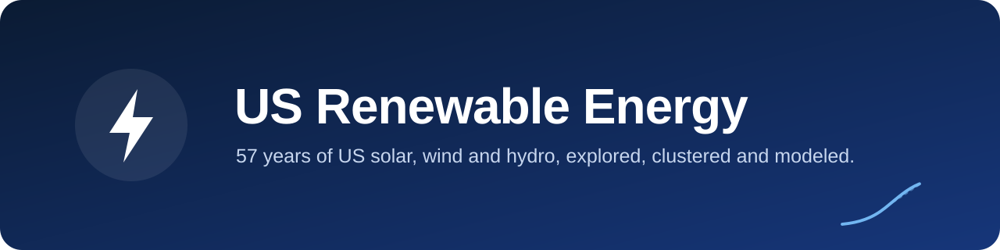
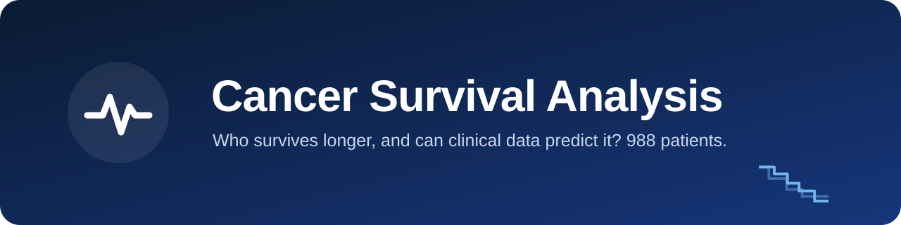
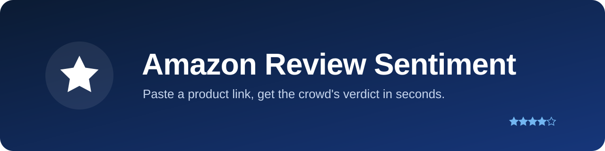

I'm a data scientist and AI engineer in Seattle. I build LLM-powered platforms, production ML pipelines and GenAI systems. My work runs from fine-tuning language models to shipping pipelines on Azure Databricks and AWS. I think in business outcomes, not only accuracy scores, and I like closing the gap between research and products that ship.

I hold an M.S. in Data Science from CU Boulder. Along the way I've published an IEEE paper, authored an Indian patent and presented research at PVSEC-31.

## Featured work

<table>
<tr>
<td width="50%" valign="top">

<b>voice-alerts</b>: a friendly voice that tells you when your coding agent needs you, and what it needs. It works with Claude Code, Codex, Gemini and four more.
</td>
<td width="50%" valign="top">

<b>Aluminum predictive maintenance</b>: flags bad decoating cycles from furnace sensor data, with 94.4% accuracy and 0.988 AUC. Built for the CU Boulder DaSSA Hackathon.
</td>
</tr>
<tr>
<td width="50%" valign="top">

<b>Misinformation NLP analysis</b>: text mining across 1,054 news articles on whether platforms should answer for misinformation, from BERT labeling to topic models and SVMs.
</td>
<td width="50%" valign="top">

<b>US renewable energy</b>: 57 years of US solar, wind and hydro, merged from 17 datasets and explored with clustering, association rules and regression.
</td>
</tr>
<tr>
<td width="50%" valign="top">

<b>Cancer survival analysis</b>: Kaplan-Meier survival curves and four regression models on 988 patients, a team project.
</td>
<td width="50%" valign="top">

<b>Amazon review sentiment</b>: paste a product link to get a VADER and BERT sentiment split plus an AI summary, in a React and Flask web app.
</td>
</tr>
</table>

## Toolkit

